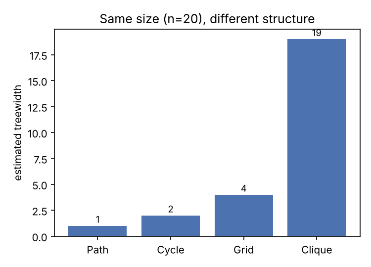
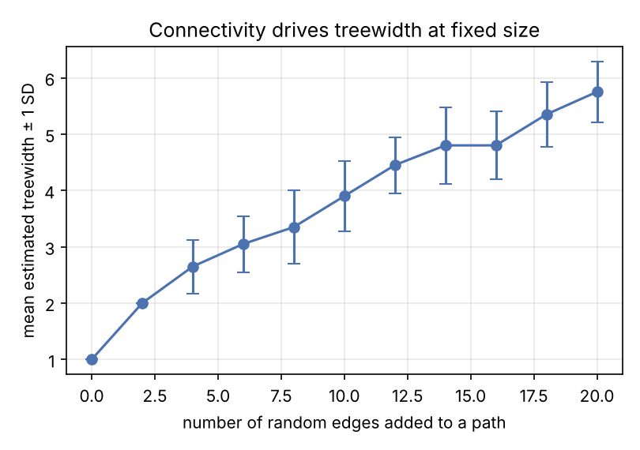
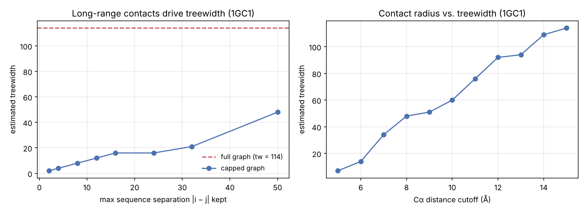

# Graph-Theoretic Analysis of Protein Sequence Design with Potts Models

Exact optimization of a Potts model is exponential in the **treewidth** of its interaction graph but not in the number of variables. A protein structure can be represented as a graph where each node is a residue and there is an edge between residues that are close in space. Since exact optimization of Potts models are not strictly dependent on the number of residues in a protein, what other metric of a protein that can predict exact solvability? In other words, what controls a protein contact graph's treewidth?

This repo explores this question first on synthetic graphs and then on real protein structures. Treewidth is NP-hard to compute exactly, so I use NetworkX's min-fill-in heuristic, which gives an upper bound.

The synthetic experiments run with no external data. The protein experiments need PDB files from [RCSB](https://www.rcsb.org/); `experiments/proteins.py` downloads nothing, it reads local files.

## Synthetic graphs: structure matters at fixed size

Four graphs on 20 nodes have very different treewidth:

| Graph | Edges | Treewidth |
|---|---|---|
| Path | 19 | 1 |
| Cycle | 20 | 2 |
| Grid (4×5) | 31 | 4 |
| Clique | 190 | 19 |



Starting from a path and adding random edges, treewidth grows about linearly with the number of edges (20 trials per point, error bars are ±1 SD):



These graphs have the same number of nodes, different connectivity, different treewidth. Hence, protein size does uniquely predict exact optimization feasibility.

## Protein contact graphs

I built Cα contact graphs (edge if two residues are within a distance cutoff) for several proteins of different sizes and folds, at a 15 Å cutoff:

| Protein | Residues | Density | Treewidth |
|---|---|---|---|
| 1CRN | 46 | 0.66 | 25 |
| 1UBQ | 76 | 0.50 | 41 |
| 1AKE | 214 | 0.22 | 97 |
| 1TIM | 247 | 0.22 | 114 |
| 1GC1 (chain G) | 297 | 0.16 | 114 |

Density doesn't track treewidth, illustrated by the fact that 1GC1 has the lowest density but one of the highest treewidths. Average degree does: across a cutoff sweep on 1GC1, treewidth and average degree correlate at r = 0.96.



## The main result: long-range contacts drive treewidth

On 1GC1, about 72% of contacts are long-range (sequence separation |i − j| > 12). Those are what make the graph hard. If I keep only contacts up to a sequence-separation cap and drop the rest, treewidth collapses:

| Contacts kept | Treewidth |
|---|---|
| full graph | 114 |
| &#124;i − j&#124; ≤ 12 | 12 |

A protein's long-range contacts, rather than its length or local structure, make exact Potts optimization intractable. This is the reason the exact solver in my [beyond-native-recovery](https://github.com/avaallwardt/beyond-native-recovery) repo restricts couplings to a sequence-neighbor window: capping |i − j| bounds treewidth, which is what keeps the exact solve feasible. This repo measures the trade-off that move is making.

## Layout

```
src/graphs.py            synthetic graph builders + treewidth estimate
src/contacts.py          PDB -> Cα contact graph + stats (needs Biopython)
experiments/synthetic.py reproducible: reference graphs + random-edge sweep (writes figures)
experiments/proteins.py  protein survey, cutoff sweep, long-range experiment (needs PDB files)
results/                 figures + the scripts that regenerate them
notebooks/treewidth-analysis.ipynb   full walkthrough
```

## Reproduce

Synthetic part, no data needed:

```bash
python -m venv .venv && source .venv/bin/activate
pip install -r requirements.txt
PYTHONPATH=. python experiments/synthetic.py
python results/make_protein_figure.py        # protein figure from recorded numbers
```

Protein part — download the PDB files first, then:

```bash
PYTHONPATH=. python experiments/proteins.py <dir with 1GC1.pdb, 1UBQ.pdb, ...>
```

## Notes

The protein numbers in this README and in `results/make_protein_figure.py` are from my runs on the downloaded structures; `experiments/proteins.py` regenerates them. I did this as an ML researcher at the Broad Institute of MIT and Harvard.
